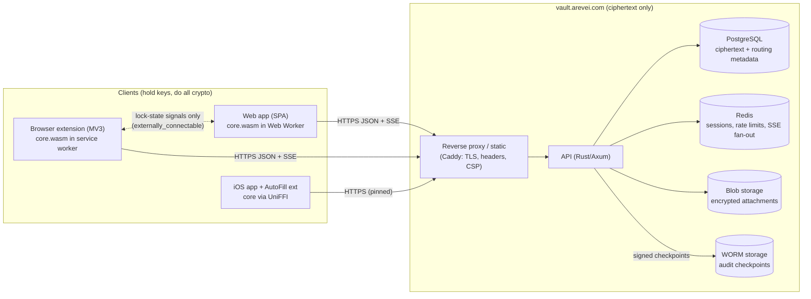
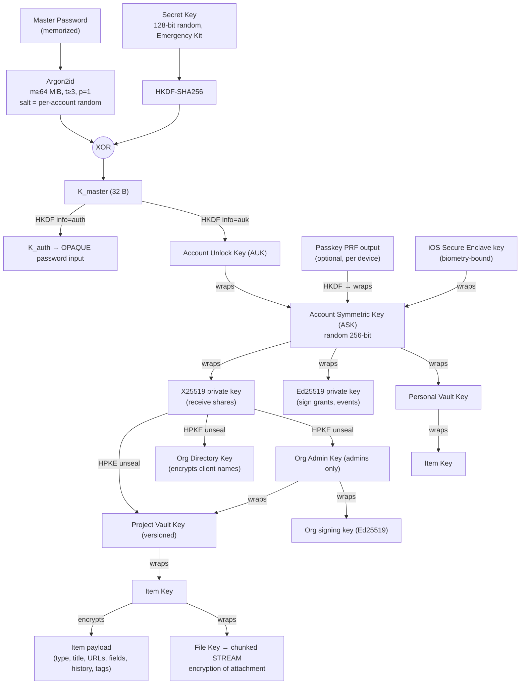
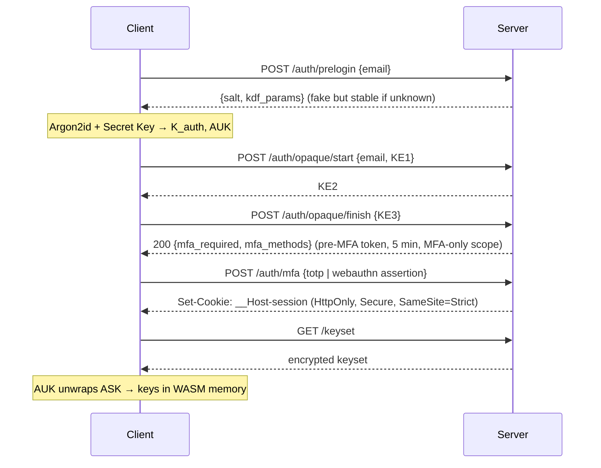
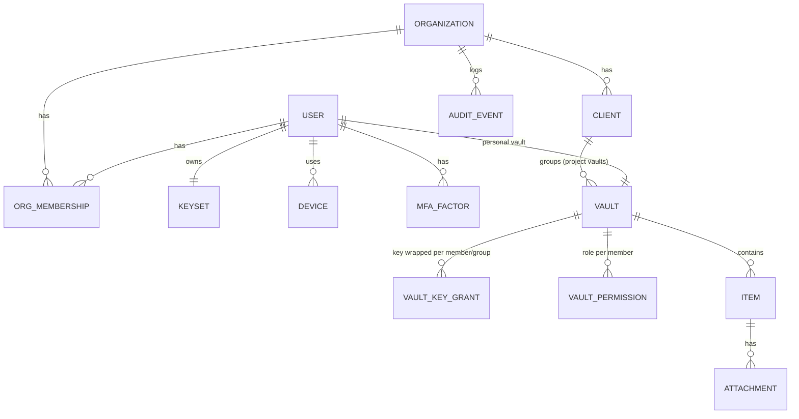
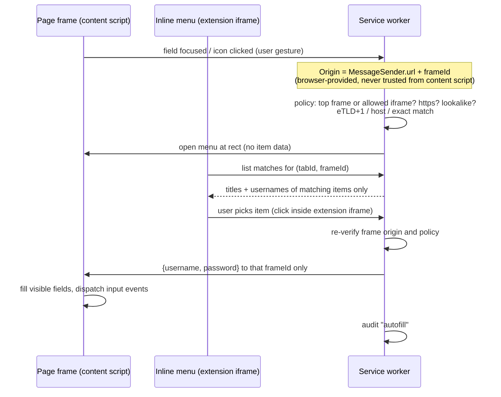

# Arevei Vault — Architecture

Status: **Draft for approval** (Milestone 0). No code is written until this document and [threat-model.md](threat-model.md) are approved.

---

## 0. Assumptions for the unfilled placeholders

The brief leaves several values open. I've designed against these defaults. Every one of them can change without touching the crypto or the data layer. See §22 for the decisions I need from you.

| Placeholder | Assumed default |
|---|---|
| Company type | Digital agency managing client credentials |
| Team size / volume | ≤ 50 users, ≤ 200 clients, ≤ 1,000 projects, ≤ 50,000 items. The design scales well past this. |
| Hosting | Docker Compose on a single host for v1, with IaC for AWS as the cloud path |
| Domain | `vault.arevei.com` (web app + API on the same origin) |
| Tenancy | Arevei only at launch, with a multi-tenant (organization-scoped) data model from day one |
| Attachment limit | 10 MB per file |
| iOS minimum | iOS 17. TOTP AutoFill needs iOS 18 (see §14). |
| Extension targets | Chrome/Edge/Brave first, Firefox second, Safari in Phase 4 |

---

## 1. Goals and non-goals

**Goals**
- Zero-knowledge: the server stores and syncs ciphertext and the metadata needed for routing. It cannot decrypt vault contents, item titles, URLs, client names, or project names.
- One crypto implementation (Rust `/core`) used by every client: web via WASM, extension via WASM, iOS via UniFFI.
- The Phase 1 data model already supports Phase 3 sharing, roles, and audit, and Phase 4 iOS.
- OWASP ASVS Level 2 minimum. Level 3 controls where they're cheap, such as the crypto and auth chapters.

**Non-goals (stated explicitly so nobody assumes they're covered)**
- Protecting secrets on an endpoint that's already compromised (malware, keylogger, or a malicious extension with full host access while the vault is unlocked). We reduce exposure but can't solve this. See the threat model.
- Hiding *who has access to what* from the server. The server sees the access graph (user ↔ vault IDs), because it has to enforce it.
- Cryptographically enforcing "copy-only" or "read-only". Anyone who can read a secret can exfiltrate it. These are policy controls, enforced by the server and the UI (§8.4).

---

## 2. Stack decisions

| Layer | Choice | Notes |
|---|---|---|
| Crypto/vault core | **Rust** (`/core`), compiled to WASM (`wasm-bindgen`) and Swift (`uniffi`) | As recommended |
| Backend | **Rust + Axum**, `sqlx` (compile-time checked SQL), PostgreSQL 16, Redis 7 | Picked over NestJS. It shares types and the `opaque-ke` implementation with `/core`, so we have one language for all security-critical code and no second OPAQUE implementation. |
| Web app | **React + TypeScript + Vite SPA**, Tailwind, shadcn/ui (Radix), Lucide | **Not Next.js.** A static SPA gives fully static, content-hashed bundles that are easy to build reproducibly and publish hashes for. It also has no server-rendering code path that could touch vault pages. |
| Extension | Manifest V3, TypeScript, Vite build, shares `/packages/ui` | As recommended |
| iOS | SwiftUI + AutoFill Credential Provider + Safari Web Extension | As recommended |
| Monorepo | Cargo workspace + pnpm workspaces | |

**Rust crates (all local libraries; none of them send data anywhere):** `argon2`, `chacha20poly1305`, `hkdf`, `sha2`, `sha1` (TOTP SHA-1 and HIBP only), `hmac`, `x25519-dalek`, `ed25519-dalek`, `hpke` (RFC 9180), `opaque-ke`, `zeroize`, `secrecy`, `getrandom` (backed by `crypto.getRandomValues` on WASM), `ciborium` (CBOR), `unicode-normalization`, `publicsuffix`, `zxcvbn`, `rqrr` + `image` (QR decoding), `csv`, `webauthn-rs` (server only), `uniffi`, `wasm-bindgen`.

**Crypto primitive choice: XChaCha20-Poly1305.** It uses 192-bit random nonces, so random nonce generation is safe at any volume. It's also constant-time in pure software, which matters because WASM has no AES-NI. AES-256-GCM isn't used anywhere except where Apple APIs mandate it (Secure Enclave ECIES, §14).

---

## 3. Component overview



Each client is a full, independent client with its own session. **Key material never crosses between the web app and the extension** (§13.7).

---

## 4. Key hierarchy

### 4.1 Diagram



### 4.2 Derivation (two-secret key derivation)

```
salt          = 16 random bytes per account (server-stored, returned by /auth/prelogin)
K_pw          = Argon2id(NFKD(master_password), salt, m, t, p, out=32)
K_sk          = HKDF-SHA256(ikm=SecretKey, salt=salt, info="arevei-vault/v1/secret-key")
K_master      = K_pw XOR K_sk
K_auth        = HKDF-SHA256(K_master, info="arevei-vault/v1/opaque-password")
AUK           = HKDF-SHA256(K_master, info="arevei-vault/v1/account-unlock-key")
```

- **Why two secrets:** a full database dump (OPAQUE records included) doesn't allow an offline master-password guessing attack, because every guess also needs the 128-bit Secret Key, which the server never sees.
- **KDF parameter floor is enforced by the client.** Clients refuse to derive with parameters below m=64 MiB / t=3 / p=1, whatever the server says. Parameters are also bound into the keyset envelope's associated data, so a malicious server can't silently downgrade them. Parameters are versioned so they can be raised later. Raising them re-wraps the ASK only and re-encrypts nothing else.
- **OPAQUE's internal key-stretching function is set to identity.** `K_auth` is already stretched by Argon2id, and running Argon2 twice would double unlock latency for no gain.
- **Unknown emails:** `/auth/prelogin` returns deterministic fake salts and params (`HMAC(server_secret, email)`), and `opaque-ke` runs a fake-record flow. Account enumeration is not possible through either endpoint.
- **Secret Key format:** `AV1-` prefix, 128 random bits in Crockford base32, grouped for readability, plus a check character to catch typos.

### 4.3 What each key protects

| Key | Generated | Wrapped by | Stored where |
|---|---|---|---|
| ASK | Signup | AUK; optionally passkey-PRF key; iOS SE key | Server (ciphertext "keyset") |
| X25519 / Ed25519 keypair | Signup | ASK (private); public halves stored plaintext and signed (§8.2) | Server |
| Personal Vault Key | Signup | ASK | Server |
| Project Vault Key vN | Project creation / every rotation | HPKE to each member's X25519 key (signed grant), and symmetrically by the Org Admin Key (`admin_wrapped_key`) | Server (`key_grants`, `vaults`) |
| Org Directory Key | Org creation | HPKE to every approved member | Server. Encrypts client names. Every org member can read the client list but no project contents; that's an accepted tradeoff inside one agency. |
| Org Admin Key | Org creation | HPKE to each Owner/Admin | Server. Also wraps the org signing key (`org_secrets`). |
| Item Key | Item creation, move, or first edit after a vault rotation | Vault key | Inside the item row |
| File Key | Attachment upload | Item key | Attachment row |

**Changing the master password or Secret Key** re-wraps the ASK only. **Item keys exist** so that moving an item, or handling key rotation, never requires re-encrypting other items.

### 4.4 Wrapping primitives

- **Symmetric wrap** (AUK→ASK, ASK→keys, vault key→item key, item key→file key): the XChaCha20-Poly1305 envelope (§5) with an associated-data context.
- **Asymmetric wrap** (vault key → member): **HPKE base mode, RFC 9180**, DHKEM(X25519, HKDF-SHA256) / HKDF-SHA256 / ChaCha20Poly1305. The `info` field binds `org_id | vault_id | recipient_user_id | key_version`. Every grant is also **signed with the granter's Ed25519 key** (§8.2).
- **Attachments:** the `chacha20poly1305` crate's STREAM construction (XChaCha20-Poly1305, BE32 counter, 64 KiB chunks). This gives truncation and reordering resistance without loading the whole file into memory.

---

## 5. Encrypted envelope format

Every ciphertext uses one versioned binary envelope:

```
byte 0       format version (0x01)
byte 1       algorithm id (0x01 = XChaCha20-Poly1305)
bytes 2..17  key id (16 B: identifies which key/version wrapped this)
bytes 18..41 nonce (24 B, random)
bytes 42..   ciphertext || 16 B tag
```

- **Associated data** is a domain-separated, length-prefixed encoding (`core/src/encoding.rs` `Aad`) of `("arevei-vault/v1", object_type, vault_id, object_id, object_version, key_version)`. The envelope header is authenticated too. This defeats **swap and replay attacks**: the server can't move an item ciphertext into another vault or slot, or present a field from item A as item B, without failing authentication.
- **Plaintext payloads** are JSON (the AAD carries all the binding, so canonical encoding isn't needed), **padded with the Padmé scheme** to a 64-byte minimum before encryption. This limits length leakage (password length, note length) to within about 12%.
- **Memory:** all keys live in Rust types that implement `ZeroizeOnDrop`. JS only ever holds opaque handles to keys, never raw key bytes.

---

## 6. Authentication, sessions, and unlock

### 6.1 Signup
1. The client generates the salt, Secret Key, ASK, X25519/Ed25519 keypairs, and Personal Vault Key.
2. It checks the master password with zxcvbn and requires a score ≥ 3 (computed in `/core`, so all platforms agree).
3. It derives `K_auth` and the AUK, then runs OPAQUE registration with `K_auth`.
4. It uploads the OPAQUE registration record, the encrypted keyset, the public keys, and the KDF params.
5. **Mandatory account 2FA enrollment** (TOTP or WebAuthn) happens before the vault becomes usable.
6. **Emergency Kit PDF is generated client-side** (`pdf-lib`, no network). It contains the email, sign-in URL, Secret Key, a QR setup code, and a blank space for the master password. The user must confirm they saved it, by re-entering the last 4 characters of the Secret Key, before continuing.

### 6.2 Login (new session)


- **New device** means no Secret Key is cached locally. The user types the Secret Key or scans the Emergency Kit QR, or the QR shown by an already-signed-in device. A successful login from a new device triggers a **new-device email alert**.
- **Rate limiting** (Redis, sliding window): per account (5 failures → exponential backoff, 20 → 1 h lock plus an email to the user), per IP, and per /24 subnet. MFA attempts are limited separately.
- **Session tokens:** 256-bit random values stored hashed (SHA-256) in Redis and Postgres. They have both idle and absolute timeouts, are bound to a `device_id`, and can be revoked from Settings → Devices.
- **CSRF:** `SameSite=Strict` plus a required custom header (`X-Arevei-Request: 1`) on all state-changing requests, plus an Origin check.

### 6.3 Lock and unlock (session still valid)
- **Lock** wipes all key material. The web app terminates the crypto Worker, which frees WASM memory wholesale, clears UI state, and reloads the page to purge the JS heap. The extension clears `chrome.storage.session` and in-memory state.
- **Unlock with master password:** the client re-derives the AUK locally, using the cached Secret Key and the cached, authenticated keyset, then unwraps the ASK. No server round trip is needed.
- **Unlock with passkey (optional, per trusted device):** the WebAuthn **PRF extension** output → HKDF → a device unlock key that wraps a copy of the ASK. That wrapped copy is stored server-side per credential, and the server can't unwrap it. User verification is required. Where the platform doesn't support PRF, the master password is the fallback.
- **Auto-lock:** after inactivity (default 5 min, configurable 1–60 min), on OS lock or idle, and on browser close. Keys are memory-only, so browser close is inherently a lock.
- **The cached Secret Key on the web** is stored in IndexedDB *wrapped by a non-extractable WebCrypto AES key*, so the raw value can't be read back out by script. On its own it's useless without the master password. Users can choose "Don't remember on this device".

### 6.4 Account recovery
See §9.

---

## 7. Data model (server view)

The full PostgreSQL DDL is the next deliverable. This section shows the shape and, most importantly, **what is plaintext versus ciphertext**.



| Entity | Plaintext (server can see) | Encrypted (server can't see) |
|---|---|---|
| organization | id, created_at, plan | name, settings blob |
| user | id, email, created_at, status | display name (in keyset) |
| keyset | user_id, kdf params, version, public keys and their membership certificate | ASK-wrapped private keys, personal vault key |
| client | id, org_id | name, notes (Client Key) |
| vault | id, org_id, client_id or owner_user_id, kind (`personal` / `project`), current key_version, revision | name, description |
| vault_permission | vault_id, user_id, role, copy_only flag | — |
| vault_key_grant | vault_id, key_version, recipient (user or group), grantor_id, signature | wrapped vault key |
| item | id, vault_id, version, revision, size bucket, created/updated_at, created/updated_by, deleted_at | **everything else**: type, title, URLs, username, password, TOTP, notes, custom fields, tags, password history (last 10), expiry date |
| attachment | id, item_id, size bucket, chunk count | file name, MIME type, content |
| user_prefs | user_id | favorites, UI preferences, recent items |
| audit_event | see §11 | — (item titles are never logged, only IDs) |

Notes:
- **Every table carries `org_id`**, and Postgres **Row-Level Security** is enabled as defense in depth behind the API's authorization checks.
- **Item type is encrypted**, so the server can't tell how many SSH keys or how many logins exist.
- **Favorites are per-user and encrypted**, not a plaintext column.
- **Expiry reminders are computed client-side** by default. Server-side email reminders would need a plaintext date, so they're opt-in per item and reveal only "item X has a date".
- **Trash:** a `deleted_at` timestamp. A server job hard-deletes rows (and attachment blobs) 30 days later.
- **Favicons are not fetched.** Fetching site icons leaks URLs to an icon service. Avatars are monochrome initials, which also fits the brand.

---

## 8. Sharing, roles, and offboarding (Phase 3, modeled now)

### 8.1 Roles
Roles are per-org (`owner`, `admin`, `member`), and project access is per-vault (`manager`, `member`, `read_only`, plus a `copy_only` flag).

| Capability | Enforced by |
|---|---|
| Ability to decrypt a project | **Cryptography** (holding a vault key grant) |
| Write, delete, share, manage members | **Server ACL** (role check on every request) + client UI |
| Read-only, copy-only | **Server ACL + client UI policy only** (see §8.4) |
| Admins can't see Personal Vaults | **Cryptography.** The Personal Vault Key is wrapped only by the user's own ASK, with no escrow (§9). |

Admins and Owners share an **Org Admin Key**, a symmetric key HPKE-granted to each admin. Every project vault key is also wrapped under it (`admin_wrapped_key`). That lets admins add members to any project, and adding a new admin is a single grant rather than one per project.

### 8.2 Key authenticity (preventing server key substitution)
A malicious server could hand out its own public key in place of a colleague's, then receive vault keys. It could also create a fake vault whose key it knows and get users to save secrets into it. The defenses:

1. **Membership certificates.** When an admin approves a new member, the admin's client signs `(org_id, user_id, email, x25519_pub, ed25519_pub, issued_at)` with the **org signing key**, an Ed25519 key held by the Admins group.
2. **Org root fingerprint pinning.** Each member's client pins the org signing public key at onboarding (trust on first use). Its fingerprint is shown under Settings so it can be verified out of band, for example read aloud in a team call.
3. **Before wrapping a vault key to anyone**, the client verifies the recipient's membership certificate against the pinned root.
4. **Every vault key grant is signed** by the granter. Recipients reject grants not signed by a certified member, and the UI shows who granted access.

*This needs a professional audit (§21).*

### 8.3 Revocation and key rotation
Removing a member from a project, or offboarding them:
1. The server immediately deletes their grants and permissions and revokes all their sessions.
2. The acting admin's client generates **Vault Key v(n+1)**, re-wraps every item key under it, and re-grants it to the remaining members and the Admins group. The cost is one small wrap per item, with no re-encryption of payloads.
3. **Any item written after rotation gets a fresh Item Key.**
4. **Offboarding report:** a list of every credential the departed user could decrypt, prioritized by sensitivity. **Rotating the actual passwords and keys at the source services is the only real revocation.** The former member may have copied or cached anything they could see. The UI says this plainly and tracks rotation progress.

"Offboard user" performs steps 1–4 across every project in one action, and the result is audit-logged.

### 8.4 Read-only and copy-only, honestly
A read-only or copy-only member holds the vault key, as they must in order to read or copy. The server rejects their writes, and the UI hides reveal for copy-only items. **A technically capable user could still extract the plaintext** with devtools, a modified client, or simply by pasting. Use these as workflow guardrails, not as security boundaries. The UI copy will say so.

---

## 9. Recovery

| Path | What it recovers | How |
|---|---|---|
| **Forgot master password, has Emergency Kit** | Nothing. The Secret Key alone doesn't recover the master password. | That's the point of the design. Without the master password, use admin-assisted recovery. |
| **Lost Secret Key, knows master password, has a signed-in device** | Everything | Any unlocked device can show the Secret Key and QR (requires master password re-entry). |
| **Admin-assisted recovery (team accounts)** | **Shared project access only** | The user resets their credentials, which generates a new keyset. An admin approves the request and re-grants the user's project vault keys to their new public key, after a new membership certificate is issued. The user is notified by email at request, approval, and completion. Everything is audit-logged. |

**Deviation from the brief, for your approval.** The brief asks for an "escrowed recovery key" but also says admins must never be able to see Personal Vaults. Those two conflict. If the recovery key could unwrap the ASK, an admin could read the Personal Vault. I'm proposing:
- No escrow by default. Admin-assisted recovery works through re-granting, which needs no escrow, because the Admins group already holds every project vault key.
- **Personal Vault contents are lost without the master password.** The user is told this clearly at signup.
- Optionally, a per-user opt-in "Allow my organization to recover my personal vault" that escrows the Personal Vault Key to the Admins group, with a clear consent screen. **Off by default.**

---

## 10. Sync protocol

- **Revision counters:** each organization has a monotonically increasing `revision`. Every mutation (item create, update, delete, or move, a key rotation, or a grant change) bumps it in the same transaction, and the mutated rows store the new revision.
- **Pull:** `GET /sync?since=<revision>` returns item rows changed since that revision in the vaults the caller can access. It also returns the full, small lists of vaults, clients, grants, and members, so revocations take effect on the next pull. `since=0` returns everything accessible.
- **Push:** `PUT /vaults/{vid}/items/{iid}` with `If-Match: <item.version>`. The server rejects a stale version with `409` and the current row. The client then does a **three-way field-level merge** using the base version. If both sides changed the same field, the most recent change wins and the losing password value goes into password history. Nothing is ever silently dropped.
- **Realtime:** Server-Sent Events (`GET /events`) carry only `vault {id} revision {n}` notifications, never content. Clients then pull.
- **Rollback detection:** clients persist a per-vault high-water revision and per-item version. Each item's version is inside the ciphertext's associated data. A server that serves an older vault revision or an older item version than the client has already seen triggers a visible integrity warning. (A server that withholds or deletes items can't be prevented. That's an availability attack, not a confidentiality one, and is documented in the threat model.)
- **Offline cache:** ciphertext only. On the web it goes in IndexedDB, in the extension in `chrome.storage.local`, and on iOS in the App Group container (for the AutoFill extension). Plaintext is never persisted.

---

## 11. Audit logging

**Events:** login, failed login, MFA changes, new device, lock/unlock, item view, reveal, copy (by field), autofill, create, edit, move, delete, restore, share, revoke, role change, key rotation, export, import, recovery request/approval, and settings changes.

**Fields:** `id, org_id, ts (server), actor_user_id, device_id, session_id, ip, user_agent, event_type, target_type, target_id (item/vault ID, never a title), client_ts, prev_hash, entry_hash`. Admins see titles in the audit UI because their client decrypts item IDs into titles locally.

**Tamper evidence:**
- **Hash chain:** `entry_hash = SHA-256(prev_hash || canonical_cbor(entry))`, kept per organization.
- **Append-only at the database level:** the app's Postgres role has `INSERT` and `SELECT` only on `audit_event`, and a trigger rejects `UPDATE` and `DELETE`.
- **Hourly checkpoints:** the latest `entry_hash` and count, signed with the server's Ed25519 audit key, written to **WORM storage** (S3 Object Lock in compliance mode, or an append-only file shipped off-host for self-hosting). Owners' clients also fetch and store each checkpoint locally, so rewriting history later is detectable by any Owner device.
- Client-originated events (view, reveal, copy, autofill) are signed with the device's Ed25519 key, which attributes them to a specific device.

**An honest limitation:** view, reveal, copy, and autofill happen on the client, after the vault has already been synced and decrypted. **The server can only log what an honest client reports.** A modified client can skip the report. Server-observable events, such as sync downloads, logins, writes, and shares, are logged regardless of the client.

---

## 12. Web app security architecture

### 12.1 Delivery and headers (set by the reverse proxy)
```
Content-Security-Policy:
  default-src 'none';
  script-src 'self' 'wasm-unsafe-eval';
  style-src 'self';
  img-src 'self' blob: data:;
  font-src 'self';
  connect-src 'self' [https://api.pwnedpasswords.com if HIBP enabled];
  worker-src 'self';
  manifest-src 'self';
  frame-ancestors 'none';
  form-action 'self';
  base-uri 'none';
  object-src 'none';
  require-trusted-types-for 'script';
  trusted-types arevei-default;
  upgrade-insecure-requests
Strict-Transport-Security: max-age=63072000; includeSubDomains; preload
Cross-Origin-Opener-Policy: same-origin
Cross-Origin-Embedder-Policy: require-corp
Cross-Origin-Resource-Policy: same-origin
X-Content-Type-Options: nosniff
Referrer-Policy: no-referrer
Permissions-Policy: camera=(), microphone=(), geolocation=(), payment=(), usb=(), clipboard-write=(self), publickey-credentials-get=(self)
Cache-Control (index.html): no-store
```
- **No third-party scripts, CDNs, analytics, or fonts.** Inter and JetBrains Mono are self-hosted.
- **Subresource Integrity:** the build adds `integrity` to every `<script>` and `<link>`. All asset filenames are content-hashed.
- **Trusted Types** plus a lint rule against `dangerouslySetInnerHTML` make DOM-XSS sinks fail closed. This matters because **shared items are authored by other users**, so a Secure Note from a colleague (or an attacker with their account) is attacker-controlled input rendered inside the vault origin.
- **Rich text Secure Notes** are stored as a structured document (ProseMirror/TipTap JSON with an allow-listed schema), never as HTML. They're rendered through React, never via `innerHTML`.
- `style-src 'self'` without `'unsafe-inline'` works with React and Radix because they set styles through CSSOM, which CSP doesn't block. This will be verified in the CSP audit test.

### 12.2 Runtime isolation
- **The crypto engine runs in a dedicated Web Worker** holding `core.wasm`. The UI thread sends commands ("unlock", "decrypt item X", "copy field Y") and receives only what it must render. Raw keys never exist in the main thread.
- **Plaintext strings in JS can't be zeroized.** That's a platform limitation. We reduce exposure: secret fields are decrypted on demand when revealed or copied, not held in the search index. The in-memory search index holds titles, usernames, URLs, and tags only, and is dropped on lock.
- **Clipboard:** copy uses `navigator.clipboard.writeText`. After 30 s the app overwrites the clipboard with an empty string if the tab still has focus, and otherwise on the next focus. **Limitations, stated in the UI:** browsers can't clear the clipboard from a background tab, and OS clipboard history (Windows Win+V, macOS clipboard managers) may keep a copy. The extension does better (§13.5).

### 12.3 The residual risk of server-delivered JavaScript
Whoever controls `vault.arevei.com` (an attacker or a coerced operator) can serve modified JS that captures the master password at the next unlock. **This is the main weakness of every web-based zero-knowledge vault.** Mitigations:
1. **Reproducible builds plus published bundle hashes.** CI builds the web bundle in a pinned container (`cargo --locked`, `pnpm --frozen-lockfile`, `SOURCE_DATE_EPOCH`). It publishes the SHA-256 of `index.html` and every asset, signed with Sigstore/cosign, to a public transparency location outside the vault server (for example, GitHub Releases).
2. **The extension as a trusted verifier.** The extension is code-signed and distributed by browser stores, so the vault server can't change it. When you open `vault.arevei.com`, the extension fetches the served `index.html` and asset hashes and compares them with the signed manifest for the current release. It shows a ✅ "Verified build" or a 🛑 blocking warning.
3. **The extension and iOS app are the recommended high-assurance clients.** Neither loads code from the vault server. Admins can set an org policy to "unlock only in extension/iOS" for Owners and Admins.
4. Strict CSP, SRI, and HSTS preload stop network attackers and third-party injection, but **not** a compromised origin server. The threat model says so.

---

## 13. Browser extension architecture (Phase 2)

### 13.1 Contexts
| Context | Responsibilities | Holds keys? |
|---|---|---|
| **Service worker** | `core.wasm`, session, sync, matching, policy decisions, audit reporting | Yes. Unlocked keys are kept in `chrome.storage.session` (memory-only, never written to disk, restricted to trusted extension contexts), so they survive service-worker restarts but not a browser restart. |
| **Popup** | Search, recent items, copy, TOTP | Handles only; asks the service worker |
| **Offscreen document** | Clipboard write and clear | No |
| **Content script** (isolated world, all frames) | Detects login, signup, change-password, and OTP fields; draws the inline icon; captures submissions; performs the fill | **Never.** Receives only the single credential being filled, at fill time. |
| **Inline menu and save/update prompt** | Rendered as an **extension-origin iframe** (`web_accessible_resources`, `use_dynamic_url`) inside a **closed Shadow DOM** host element | Talks directly to the service worker |

**Deviation, for your approval.** The brand guide says inline menus are rendered in Shadow DOM. Shadow DOM isolates *styling*, but the page still shares the DOM process with it and can overlay, read, or interfere with it. Published clickjacking research against password-manager extensions (2025) exploited exactly this. So the Shadow DOM is the style container, and **the actual content lives in a cross-origin extension iframe** the host page can't read or script. The iframe also checks its visibility (IntersectionObserver v2 `trackVisibility`, plus opacity and overlay checks) and refuses clicks while it's obscured or transparent.

### 13.2 Permissions (each justified)
| Permission | Why |
|---|---|
| `storage` | Encrypted cache (`local`) and memory-only unlocked session (`session`) |
| `host_permissions: <all_urls>` + content script | Required to detect forms and draw the inline icon on any site. This is the one broad permission and can't be avoided for inline autofill. The content script never receives vault data except the credential the user chose for that frame. |
| `scripting` | Re-inject content scripts into tabs that were already open at install or update |
| `contextMenus` | Fill, generate password, copy TOTP |
| `offscreen` | Clipboard write and timed clear from MV3 |
| `alarms` | Auto-lock timer that survives service-worker suspension |
| `idle` | Lock when the OS locks or goes idle |
| `privacy` (**optional**, requested only during onboarding) | Turn off Chrome's built-in password saving, with explicit consent |
| `commands` (manifest key) | Keyboard shortcut for fill |
| *Not requested:* `tabs`, `webRequest`, `history`, `cookies`, `clipboardRead`, `<all_urls>` for `webNavigation` | The sender's URL comes from `runtime.MessageSender`, and the popup gets the current tab through `activeTab` |

### 13.3 Autofill flow and phishing defenses


**Rules (each one has a Playwright test):**
- **Never fill on page load.** Every fill needs a user gesture: a menu click, a keyboard shortcut, or a context menu action.
- **Origin comes from the browser**, via `MessageSender.url`, `origin`, and `frameId`, never from content-script claims.
- **Matching:** default is the registrable domain (eTLD+1, Public Suffix List **including the private section**, so `alice.github.io` doesn't match `bob.github.io`). Per-item options are exact host or exact URL. The PSL is bundled in `/core` and updated with each release.
- **Cross-origin iframes:** no fill unless the item explicitly lists that iframe origin. Same-origin iframes are allowed.
- **HTTP pages:** an inline warning, and no fill for items saved on HTTPS unless the user confirms each time.
- **Lookalike domains:** the client computes the UTS #39 confusable skeleton, flags mixed-script and Punycode, and flags edit distance ≤ 1 against the eTLD+1 values in the user's vault. A lookalike match **never** autofills and shows a full-width warning.
- **Hidden and offscreen fields:** never filled (checks for visibility, size, opacity, and covering elements).
- **TOTP:** fields are detected by `autocomplete="one-time-code"`, name heuristics, or a 6–8 digit pattern. Codes are offered only for an item that matches the current site.

### 13.4 Save, update, and generate
- The content script watches form `submit`, submit-button clicks, and Enter in password fields. For single-page apps it also detects login forms that disappear after a credential was entered.
- **The captured credential is sent to the service worker immediately**, held in memory keyed by tab (5-minute TTL), and never stored in the page.
- The save/update prompt (an extension iframe) appears in the same tab, or after the navigation completes. Destinations are Personal Vault (default) or any Client → Project where the user has write access.
- **Update detection:** the site matches an item, the username matches, and the password differs (or a change-password form shows current/new/confirm fields). The old password goes into history.
- **Generate:** on fields marked `autocomplete="new-password"`, or signup and change-password heuristics, the menu offers a generated password using the user's default generator settings.

### 13.5 Clipboard
The offscreen document writes the value, then after 30 s writes an empty string, even if the user has moved to another tab. Clearing only when the clipboard is unchanged would need `clipboardRead`, which we don't request. So we always clear, and the UI says so.

### 13.6 Replacing Chrome's password manager (onboarding)
1. Walk the user through `chrome://password-manager/settings` → Export passwords (an extension can't read Chrome's store directly), then import the CSV (§15).
2. Prompt the user to **securely delete the exported CSV**, and show a reminder until they confirm.
3. Ask for the optional `privacy` permission and set `privacy.services.passwordSavingEnabled = false`.
4. **Recommended for Arevei-managed machines:** also enforce with Chrome policies, `PasswordManagerEnabled=false` and `ExtensionInstallForcelist` for our extension, through Google Admin, GPO, or MDM. This is more robust than per-user settings and also handles private distribution.

### 13.7 Web app ↔ extension
- Uses `externally_connectable` restricted to `https://vault.arevei.com`.
- Messages allowed: `locked`, `unlocked` (no payload), `lock-now`, and `verify-build` (§12.3).
- **Key material never crosses in either direction.** Extension → web would hand keys to the least-trusted client. Web → extension would let server-delivered JS seed the trusted client.

---

## 14. iOS architecture (Phase 4)

- **Core:** an XCFramework built from `/core` via UniFFI, with the same envelope, the same associated data, and the same test vectors.
- **Face ID / Touch ID unlock:** a Secure Enclave P-256 key with access control `.biometryCurrentSet` and `kSecAttrAccessibleWhenUnlockedThisDeviceOnly`, in a shared Keychain access group. It wraps a copy of the ASK through Apple's `SecKeyCreateEncryptedData` (ECIES, cofactor X9.63 SHA-256, AES-GCM). If the enrolled biometrics change, the key is invalidated and the master password is required.
- **AutoFill Credential Provider extension:** reads the ciphertext cache from the App Group container and unlocks with Face ID. It **doesn't run Argon2 in the extension**, because the extension's memory limits are tight and a 64 MiB Argon2 run risks being killed. Master-password unlock inside the extension needs device testing (flagged in §21).
- **QuickType suggestions require `ASCredentialIdentityStore`**, which stores domain and username **unencrypted in the OS store**. This is a tradeoff: proposed as an opt-in setting, off by default. Without it, AutoFill still works through the "Passwords" picker.
- **TOTP AutoFill** (`ASOneTimeCodeCredentialIdentity`) requires **iOS 18**. With an iOS 17 minimum, iOS 17 devices get password AutoFill and in-app TOTP copy only.
- **Privacy screen** in the app switcher, auto-lock on background, **SPKI pinning** (primary plus a backup pin of an offline key), and no third-party SDKs.
- **Safari Web Extension** reuses `/extension` with a Safari build target.

---

## 15. Feature-level designs (Phase 1)

| Feature | Design |
|---|---|
| **Search (Cmd/Ctrl+K)** | In-Worker index over decrypted titles, usernames, URL hosts, tags, and client and project names. Prefix plus fuzzy matching. Dropped on lock. |
| **Password generator** | In `/core`, using the OS CSPRNG. Character mode removes modulo bias by rejection sampling. Passphrase mode uses the EFF large wordlist (bundled, 12.9 bits per word). Shows an entropy estimate. |
| **TOTP** | RFC 6238 in `/core` (SHA-1/256/512, 6–8 digits, any period). Parses `otpauth://` URIs. QR images are decoded **locally** with `rqrr`, either uploaded or pasted from the clipboard. |
| **Recovery codes** | A list with a per-code "used" flag and timestamp, all inside the encrypted payload |
| **Import** | Parsers in `/core`: Chrome/Google CSV, Bitwarden (JSON/CSV), 1Password (1PUX/CSV), LastPass CSV, and generic CSV with column mapping. All client-side, with a preview and dry run before writing. Batched uploads. Target: a 500-item Chrome CSV in under 10 s. |
| **Encrypted export** | A versioned file format: Argon2id(export password) → XChaCha20-Poly1305 over canonical CBOR. Re-importable. |
| **Plaintext CSV export** | Needs master-password re-entry plus an MFA step-up, then a full-screen warning. Cells are escaped against **CSV formula injection** (`=`, `+`, `-`, `@`, tab, and CR prefixes). Audit-logged. |
| **Security dashboard** | Computed client-side: weak (zxcvbn < 3), reused (comparing in-memory hashes), old (> 365 days unchanged), missing 2FA (a login with no TOTP on a site known to support 2FA, using a bundled 2fa.directory snapshot), and expiring API keys and certificates. |
| **HIBP breach check** | **Opt-in per org** (decision needed, §22). k-anonymity: the client sends the first 5 hex characters of SHA-1 directly to `api.pwnedpasswords.com` with `Add-Padding: true`. Never proxied through our server. |
| **Item types** | Login, Authenticator, Recovery Codes, API Key, SSH Key (with in-client generation of Ed25519 keys and fingerprints), Server/Database, Secure Note, File Attachment, and custom fields (text, hidden, URL, date) on every type |

---

## 16. Design system implementation

- **One source of truth:** `/packages/ui/tokens/tokens.json` is compiled into CSS variables for web and extension, Tailwind theme config, and Swift `Color` and asset catalog entries for iOS. That's one source of tokens across all three clients.
- Dark mode by default, with light mode following `prefers-color-scheme` and a manual override. 8 px grid, 8–12 px radius, 1 px borders, Lucide icons at 1.5 px stroke, 150–200 ms ease-out motion that respects `prefers-reduced-motion`.
- **Revealed passwords** are rendered in `/core`-tokenized spans: letters, digits, and symbols, with optional per-character index numbers on hover for reading aloud.

**Accessibility conflicts in the brand palette, with proposed fixes.** I checked the token contrast ratios against WCAG 2.2 AA:

| Issue | Measured | Proposed fix |
|---|---|---|
| Light-mode `--silver` #A8A9AD for focus rings and active states on #FFFFFF | **≈ 2.3:1** (needs 3:1 for UI components) | Add `--silver-strong` (light) ≈ **#6E6F73** (≈ 5:1) for focus rings, active icons, and **digit/symbol coloring in revealed passwords** on light backgrounds. Keep #A8A9AD for decoration only. Dark mode #C0C0C0 on #0A0A0A ≈ 10.9:1 is fine. |
| Light-mode password digits/symbols in `--silver` | ≈ 2.3:1 (needs 4.5:1, since this is text) | Use `--silver-strong` as above. This also follows the brand rule "silver is never body text on white". |
| Input borders `--border` #D9D9D9 on #FFFFFF and #2A2A2A on #0A0A0A | ≈ 1.4:1 / ≈ 1.3:1 (an input boundary needs 3:1 when it's the only indicator) | Keep `--border` for dividers and add `--border-input` ≈ #8F8F8F light / #6B6B6B dark |
| Dark `--silver-gradient` (#3A3A3A → #C0C0C0 → #6B6B6B) as a primary button fill | Neither black nor white text reaches 4.5:1 across the whole gradient | Primary buttons use a solid `--primary` fill with a 1 px silver-gradient border or sheen. The gradient fill is reserved for the logo and the unlock-screen mark. |

All final values are checked by an automated contrast test in CI.

---

## 17. Monorepo layout

```
/core                 Rust: crypto, key hierarchy, envelope, item models, TOTP,
                      generator, zxcvbn, PSL matching, import/export, sync client logic
  /core/wasm          wasm-bindgen bindings (web + extension)
  /core/ffi           UniFFI bindings (iOS)
  /core/vectors       golden cross-platform test vectors (JSON)
/server               Rust/Axum API, sqlx migrations, OpenAPI (utoipa-generated + checked in)
/web                  React/Vite SPA
/extension            MV3 extension (Chromium + Firefox builds; Safari in Phase 4)
/packages/ui          shared React components (shadcn-based), tokens, icons
/packages/client      shared TS: API client, Worker protocol, state stores
/ios                  SwiftUI app + AutoFill extension + Safari extension (Phase 4)
/e2e                  Playwright suites + fixture sites (phishing, iframe, http, SPA login)
/deploy               docker-compose, Caddyfile, Terraform (AWS), backup scripts
/docs                 architecture, threat model, guides, ADRs
```

---

## 18. Deployment

- **Docker Compose (self-host):** `caddy` (TLS via ACME, static web bundle, security headers), `api`, `postgres`, `redis`, an attachment volume, and a `backup` sidecar.
- **Cloud (Terraform, AWS reference):** ECS Fargate, RDS Postgres (encrypted, PITR), ElastiCache, S3 for attachments, S3 Object Lock for audit checkpoints, CloudFront in front of the static bundle (no edge functions that rewrite HTML), and KMS for server-side secrets (account TOTP seeds, OPAQUE server keypair, audit signing key).
- **Backups:** nightly `pg_dump` plus attachments, encrypted with `age` to an offline recipient key, and shipped off-host with retention of 30 daily and 12 monthly. **Backups contain only ciphertext vault data, but they also contain OPAQUE records and server secrets**, so they're encrypted as well. A quarterly restore drill is documented.
- **CI/CD (GitHub Actions):** fmt and clippy, `cargo test`, `cargo llvm-cov` (fails below 80% on `/core`), `cargo deny` and `cargo audit`, `pnpm audit`, CodeQL, unit tests, Playwright, the CSP audit test, the "plaintext canary" DB dump test, reproducible-build check (built twice, hashes compared), and cosign signing plus publishing of bundle hashes. Dependencies are pinned, and the Renovate bot proposes upgrades for human review.

---

## 19. Testing strategy

- **`/core` (≥ 80% line coverage, target ≥ 90%):** published vectors for Argon2id (RFC 9106), XChaCha20-Poly1305 (draft-irtf-cfrg-xchacha / RFC 8439), X25519 (RFC 7748), Ed25519 (RFC 8032), HKDF (RFC 5869), HPKE (RFC 9180), OPAQUE (RFC 9807), HOTP/TOTP (RFC 4226 / 6238). Property tests (`proptest`) check envelope round-trips and reject every single-bit flip and associated-data mismatch. The same golden vector files run on native, on WASM (`wasm-bindgen-test`), and on Swift.
- **TOTP vs Google Authenticator:** RFC vectors plus fixed `otpauth://` URIs, with codes checked against values captured from Google Authenticator.
- **Server:** integration tests against real Postgres and Redis (testcontainers), covering auth flows, rate limits, ACL matrix tests (every role × every endpoint), RLS isolation between two orgs, and audit-chain verification.
- **Zero-plaintext acceptance test:** seed items with unique canary strings in every field, `pg_dump` plus attachment storage, and grep for each canary. Any hit fails CI.
- **E2E (Playwright):** web signup → Emergency Kit → lock/unlock → second browser context sees the same data. The extension runs in a persistent Chromium context against **local fixture sites** mapped with `--host-resolver-rules`: a legit site, a lookalike (`arevei-test.co`, a Cyrillic homograph), a cross-origin iframe, an HTTP page, a hidden-field trap, a clickjacking overlay, an SPA login, and a password-change form.
- **CSP audit:** a headless crawl of every route asserts zero CSP violations and zero third-party requests.

---

## 20. Milestones

| # | Milestone | Output |
|---|---|---|
| **M0** | **Architecture + threat model (this)** | **Awaiting your approval** |
| M1 | `/core` crypto: envelope, KDF, key hierarchy, keyset, HPKE grants, signatures, vectors | Tests ≥ 80% |
| M2 | `/core` vault: item models, TOTP, QR, generator, zxcvbn, PSL matching, lookalike detection, importers, encrypted export, sync merge logic, WASM build | Tests |
| M3 | DB schema (DDL) + OpenAPI spec | For review |
| M4 | `/server` auth: OPAQUE, MFA (TOTP + WebAuthn), sessions, rate limits, devices, alerts | Integration tests |
| M5 | `/server` vault: keysets, vaults, items, attachments, sync, SSE, trash purge, audit chain | Integration tests + canary test |
| M6 | `/web` shell, tokens, signup, Emergency Kit, unlock, passkey unlock, auto-lock | Playwright |
| M7 | `/web` vault UI, items, search, generator, TOTP, import/export, dashboard | Playwright + CSP audit |
| M8 | Deployment, CI/CD, backups, reproducible build + hash publishing | Phase 1 acceptance |
| M9–M11 | Extension: core plumbing → autofill + phishing → save/update/generate + Chrome onboarding + build verifier | Phase 2 acceptance |
| M12–M13 | Sharing UI, roles, offboarding, recovery, audit viewer | Phase 3 |
| M14+ | iOS | Phase 4 |

---

## 21. Needs a professional security audit before production

1. The `/core` key hierarchy, envelope, associated-data construction, and 2SKD derivation
2. The OPAQUE integration (identity KSF, fake-record handling) and the MFA / pre-auth token flow
3. Sharing: membership certificates, org-root TOFU pinning, signed grants, and rotation correctness
4. Admin-assisted recovery (its credential-reset path is a natural account-takeover target)
5. Extension: origin and frame checks, the inline-iframe and clickjacking defenses, and message passing
6. Web: the CSP / Trusted Types configuration and the build-verification flow
7. iOS: Keychain and Secure Enclave usage, and AutoFill extension memory behavior
8. A penetration test of the deployed server, including multi-tenant isolation

---

## 22. Decisions needed from you

1. **Backend:** do you approve **Rust/Axum** over NestJS (§2)?
2. **Web framework:** do you approve a **Vite SPA** instead of Next.js (§2)?
3. **Recovery:** do you approve **no personal-vault escrow by default**, with opt-in only (§9)?
4. **Inline menu:** do you approve **Shadow DOM + extension-origin iframe** instead of Shadow DOM alone (§13.1)?
5. **Brand tokens:** do you approve the added `--silver-strong` and `--border-input` tokens and the gradient-button change (§16)?
6. **Hosting:** self-hosted (which provider or server?) or AWS? Which region?
7. **Email provider** for new-device and recovery alerts. It sees email addresses, IPs, and device names, so it's a third-party service touching user data. Options are your own SMTP, AWS SES, or Postmark.
8. **HIBP:** enabled by default for the org, or off by default with opt-in?
9. **iOS minimum:** 17 (no TOTP AutoFill on 17) or 18?
10. **Tenancy:** Arevei-only, or plan for client tenants (affects billing and the signup flow, not the data model)?
11. **Inputs needed later:** existing logo files, the top-50 sites list for autofill acceptance, and the Firefox commitment (yes or no).
